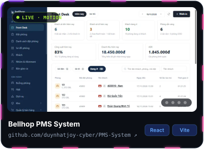
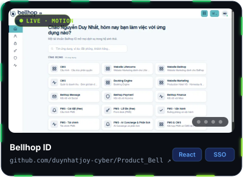
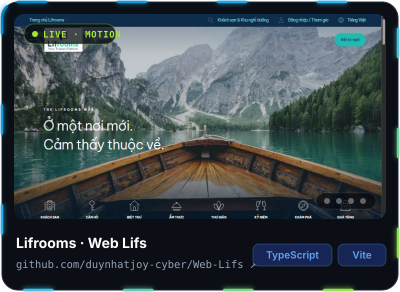
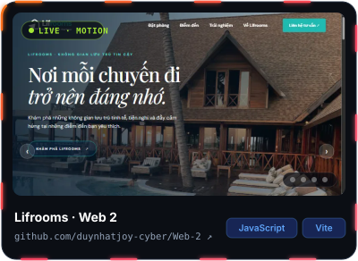
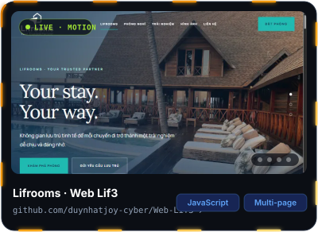
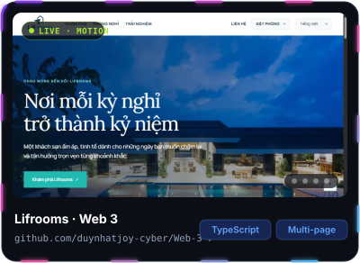

## 🚀 Featured Projects

<!-- FEATURED_PROJECTS_START -->
<table>
  <tr>
    <td align="center" width="33.33%">
      
       
      <a href="https://github.com/duynhatjoy-cyber/PMS-System">source ↗</a>
    </td>
    <td align="center" width="33.33%">
      
       
      <a href="https://github.com/duynhatjoy-cyber/Bellhop-BE">source ↗</a>
    </td>
    <td align="center" width="33.33%">
      
       
      <a href="https://github.com/duynhatjoy-cyber/Product_Bell">source ↗</a>
    </td>
  </tr>
  <tr>
    <td align="center" width="33.33%">
      
       
      <a href="https://github.com/duynhatjoy-cyber/Web-Lifs">source ↗</a>
    </td>
    <td align="center" width="33.33%">
      
       
      <a href="https://github.com/duynhatjoy-cyber/Web-2">source ↗</a>
    </td>
    <td align="center" width="33.33%">
      
       
      <a href="https://github.com/duynhatjoy-cyber/Web-Lif3">source ↗</a>
    </td>
  </tr>
  <tr>
    <td align="center" width="33.33%">
      
       
      <a href="https://github.com/duynhatjoy-cyber/Web-3">source ↗</a>
    </td>
  </tr>
</table>
<!-- FEATURED_PROJECTS_END -->
